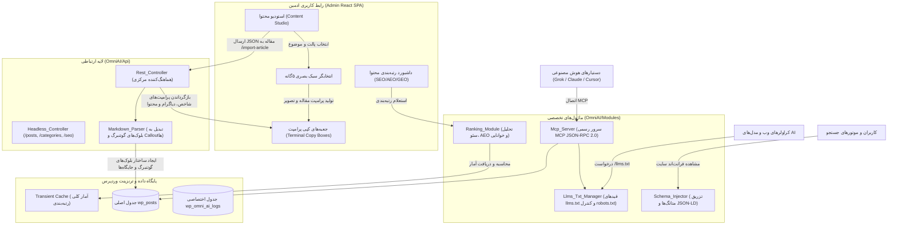

# 🏛️ مستند جامع معماری و ساختار افزونه Omni AI Suite
> **نسخه افزونه:** 1.0.0 (Architecture v2.0 - Modular & Prompt-First)  
> **محیط هدف:** WordPress 6.x + PHP 8.1+ / PHP 8.3  
> **فناوری رابط کاربری:** React بومی وردپرس (`@wordpress/element` و `@wordpress/components`) با استایل مدرن Dark Slate  
> **نوع معماری:** ماژولار مبتنی بر PSR-4، هدلس، بدون افزونگی دیتابیس (Zero DB Bloat) و جریان بصری مبتنی بر پرامپت (Prompt-First Visual Workflow)

---

## ۱. نمای کلی و فلسفه طراحی (Philosophy & Core Principles)

افزونه **Omni AI Suite** یک پلتفرم جامع، فوق‌سریع و ماژولار هوش مصنوعی برای مدیریت و تولید محتوا، سئو و رتبه‌بندی نسل جدید (SEO / AEO / GEO)، خوانایی، سرور MCP، استانداردهای مدل‌های زبانی (`llms.txt`) و چت‌بات در وردپرس است. این افزونه بر مبنای ۶ اصل کلیدی توسعه یافته است:

1. **معماری ماژولار و تفکیک وظایف (PSR-4 Autoloading):**  
   کلاس‌های حجیم پیشین به کنترلرها و ماژول‌های تک‌مسئولیتی تفکیک شده‌اند (`Headless_Controller`, `Markdown_Parser`, `Mcp_Server`, `Llms_Txt_Manager`, `Schema_Injector`) که همگی به صورت خودکار توسط `Autoloader` بارگذاری می‌شوند.
2. **جریان بصری مبتنی بر پرامپت (Prompt-First Visual Workflow):**  
   حذف وابستگی‌ها و تایم‌اوت‌های ناشی از دانلود تصاویر خارجی و رندر آنلاین دیاگرام‌ها (`mermaid.ink` و Pollinations). به جای دانلودهای ناپایدار و سنگین، سیستم پرامپت‌های مهندسی‌شده و فوق‌دقیق را در ۵ پالت سبکی به کاربر ارائه می‌دهد و درون بدنه مقاله، بلوک‌های شکیل و استاندارد گوتنبرگ (Gutenberg Callouts) به عنوان جایگاه قرارگیری تصویر و دیاگرام درج می‌کند.
3. **سرور رسمی پروتکل زمینه مدل (Model Context Protocol - MCP):**  
   مجهز به سرور رسمی MCP منطبق با استاندارد JSON-RPC 2.0 و Server-Sent Events (SSE) برای اتصال مستقیم دستیارهای هوش مصنوعی (Grok, Claude Desktop, Cursor, Antigravity) به وردپرس با ابزارهای کامل جستجو، ارزیابی رتبه، خواندن و ایجاد مقاله.
4. **استانداردهای مدرن هوش مصنوعی (`llms.txt` و `robots.txt`):**  
   تولید خودکار فیدهای متنی ساختاریافته `/llms.txt` و `/llms-full.txt` برای آموزش و ایندکس توسط مدل‌های زبانی، به همراه مدیریت دسترسی ربات‌های هوش مصنوعی در `robots.txt`.
5. **عملکرد و پایداری بالا (High Performance & Caching):**  
   کش‌کردن آمارهای کلی رتبه‌بندی سایت با ترنزینت وردپرس (`omni_ai_ranking_summary_stats`) با انقضای ۱ ساعته و پاک‌سازی هوشمند هنگام تغییر مقالات، لاگ‌گیری شرطی با ثابت `OMNI_AI_DEBUG` و حذف کوئری‌های تکراری `SHOW TABLES`.
6. **امنیت اندپوینت‌های عمومی هدلس:**  
   اجبار وضعیت انتشار (`publish`) در اندپوینت‌های عمومی `/posts` و مسدودسازی دسترسی به پیش‌نویس‌ها برای کاربران احراز هویت‌نشده.

---

## ۲. دیاگرام جریان معماری و داده‌ها (Data Flow Architecture)



---

## ۳. ساختار فایل‌ها و پوشه‌های افزونه (File Map)

```text
omni-ai-suite/
│
├── omni-ai-suite.php                   # فایل اصلی افزونه و راه‌انداز هسته
├── uninstall.php                       # اسکریپت پاک‌سازی تمیز در زمان حذف افزونه
├── package.json                        # پیکربندی اسکریپت‌های کامپایل فرانت‌اند (wp-scripts)
├── ARCHITECTURE.md                     # سند معماری و مشخصات فنی افزونه
├── README.md                           # راهنمای سریع و امکانات
│
├── assets/                             # خروجی باندل‌های نهایی و استاتیک
│   ├── css/
│   │   ├── admin.css                   # استایل مینیفای‌شده ادمین با پالت Dark Slate
│   │   └── chatbot.css                 # استایل فرانت‌اند چت‌بات شناور
│   └── js/
│       ├── admin.js                    # باندل کامپایل‌شده React SPA ادمین (Content Studio, Ranking)
│       ├── admin.asset.php             # وابستگی‌های اسکریپت ادمین وردپرس
│       ├── gutenberg.js                # افزونه سایدبار گوتنبرگ
│       └── gutenberg.asset.php         # وابستگی‌های گوتنبرگ
│
├── src/                                # کدهای منبع فرانت‌اند (React / Modern ES6)
│   ├── admin/
│   │   ├── components/                 # کامپوننت‌های مشترک (Header, ErrorBoundary)
│   │   ├── pages/                      # صفحات اصلی پنل (ContentStudio, ContentRanking, ...)
│   │   ├── styles/admin.css            # سورس استایل با کلاس‌های نئونی، تب‌های مدرن و ترمینال
│   │   └── index.js                    # نقطه ورود اصلی SPA ادمین
│   └── gutenberg/                      # سورس افزونه ویرایشگر گوتنبرگ
│
└── includes/                           # کدهای سمت سرور PHP (سازگار با PHP 8.1+)
    ├── class-plugin.php                # کلاس اصلی پلاگین و بوت‌استرپ
    ├── class-autoloader.php            # لودر خودکار PSR-4 کلاس‌های نیم‌اسپیس OmniAI
    ├── class-activator.php             # ساخت جداول دیتابیس در زمان فعال‌سازی
    ├── class-deactivator.php           # غیرفعال‌سازی و پاک‌سازی صف‌ها
    │
    ├── admin/
    │   └── class-admin.php             # مدیریت منوهای وردپرس و اینکیو اسکریپت‌ها
    │
    ├── api/                            # لایه اختصاصی REST API و پردازشگرها
    │   ├── class-rest-controller.php   # کنترلر مرکزی مسیرهای REST و پردازش پیش‌نویس/ایمپورت
    │   ├── class-headless-controller.php# کنترلر مستقل مسیرهای هدلس بلاگ و متادیتای سئو
    │   ├── class-markdown-parser.php   # تبدیل مارک‌داون به بلوک‌های گوتنبرگ و Callout دیاگرام
    │   ├── class-media-sideloader.php  # توابع کمکی ساخت پرامپت سبک‌ها و اسلاگ انگلیسی
    │   └── class-stream-handler.php    # کنترلر استریم زنده Server-Sent Events (SSE)
    │
    ├── database/
    │   └── class-log-repository.php    # مدیریت ثبت لاگ‌ها در دیتابیس با کش و دیباگ هوشمند
    │
    ├── modules/                        # ماژول‌های معماری و رتبه‌بندی
    │   ├── interface-module.php        # اینترفیس استاندارد ماژول‌ها
    │   ├── class-module-manager.php    # مدیر رجیستری و بوت ماژول‌ها
    │   ├── class-ranking-module.php    # ماژول ارزیابی هوشمند رتبه (SEO, AEO, GEO, Readability)
    │   ├── class-mcp-server.php        # سرور رسمی Model Context Protocol (JSON-RPC 2.0)
    │   ├── class-llms-txt-manager.php  # مدیریت خروجی llms.txt و دایرکتیوهای robots.txt
    │   ├── class-schema-injector.php   # تزریق متاتگ‌های سئو و اسکیماهای ساختاریافته JSON-LD
    │   ├── class-breadcrumbs.php       # ساختار مسیر راهنما و اسکیما BreadcrumbList
    │   ├── class-content-module.php    # ماژول استودیو محتوا
    │   ├── class-bulk-module.php       # ماژول صف و تولید دسته‌ای
    │   ├── class-gutenberg-module.php  # ادغام با گوتنبرگ
    │   ├── class-elementor-module.php  # ادغام با المنتور
    │   ├── class-woocommerce-module.php# ادغام با ووکامرس
    │   └── class-chatbot-module.php    # ویجت چت‌بات عمومی
    │
    └── providers/                      # درایورهای ارتباط با موتورهای هوش مصنوعی
        ├── interface-ai-provider.php   # اینترفیس پرووایدرها
        ├── class-provider-factory.php  # فکتوری حل کلیدها و Failover
        ├── class-gemini-provider.php   # درایور Google Gemini (سری ۳ و کش مدل‌ها)
        ├── class-openai-provider.php   # درایور OpenAI
        └── class-claude-provider.php   # درایور Anthropic Claude
```

---

## ۴. استراتژی جریان بصری مبتنی بر پرامپت (Prompt-First Visual Workflow)

در ویرایش جدید، تمام عملیات دانلود تصویر سمت سرور و رندر بلادرنگ Mermaid حذف شده و جای خود را به گردش کار استاندارد صنعتی داده است:

### ۱. پالت‌های ۵گانه سبک تصویر شاخص (Visual Style Presets):
کاربر در گام نخست تولید مقاله، یکی از پالت‌های بصری استاندارد را انتخاب می‌کند:
1. `dark_slate_neon`: تم تیره اداری دولوپری (`#0f172a`) با عناصر نئونی فیروزه‌ای (`#38bdf8`)، رندر ۳ بعدی آکتان و نورپردازی استودیویی.
2. `isometric_3d`: ماکت‌های ایزومتریک ۳ بعدی سرورها و بلوک‌های کد با متریال‌های مات و های‌کوالیتی.
3. `minimal_flat`: تصویرسازی فلت وکتور مینیمال متناسب با استانداردهای وبلاگ‌های Stripe و GitHub.
4. `blueprint`: بلوپرینت فنی مهندسی با شبکه‌بندی دقیق روی پس‌زمینه سرمه‌ای تیره و خطوط درخشان لیزری.
5. `glassmorphism`: کارت‌های شیشه‌ای تیره مات با گرادیان‌های نئونی و آیکون‌های معلق کد با بلور ملایم.

### ۲. بلوک‌های فراخوان گوتنبرگ برای دیاگرام و تصاویر:
هنگام پردازش مقاله، تگ‌های `[DIAGRAM_PLACEHOLDER]` یا کدهای دیاگرام به یک بلوک کانتینر اختصاصی گوتنبرگ با پس‌زمینه تیره (`#0f172a`)، حاشیه خط‌چین فیروزه‌ای (`#38bdf8`) و متن راهنمای پرامپت تبدیل می‌شوند. همچنین تگ‌های `[IMAGE_PLACEHOLDER_x]` به بلوک‌های شکیل تصویر با پرامپت پیشنهادی تبدیل می‌گردند تا نویسنده در هنگام ویرایش گوتنبرگ به سادگی تصویر دلخواه را جایگزین نماید.

### ۳. پنل جعبه‌های ترمینال کپی (Terminal Copy Boxes):
پس از ثبت مقاله، ۳ جعبه مجزا با استایل ترمینال تیره و دکمه‌های کپی سریع ۱ کلیکی برای نویسنده نمایش داده می‌شوند:
- 🌟 **پرامپت تصویر شاخص (Featured Image Prompt):** پرامپت با نسبت ابعاد ۱۶:۹ بدون متن و واترمارک.
- 📊 **پرامپت دیاگرام / اینفوگرافیک (Diagram Prompt):** پرامپت آماده برای تصویرسازهای هوش مصنوعی (Ideogram, DALL-E).
- 🖼️ **پرامپت‌های تصاویر درون متن (In-Content Prompts):** به تفکیک برای هر جایگاه داخل مقاله.

---

## ۵. سرور پروتکل زمینه مدل (MCP Server Specification)

سرور رسمی پروتکل MCP افزونه تحت مسیر `/wp-json/omni-ai/v1/mcp` با پشتیبانی از JSON-RPC 2.0 و Server-Sent Events پیاده‌سازی شده است:

| نام ابزار MCP | عملکرد ابزار | پارامترها |
| :--- | :--- | :--- |
| `search_posts` | جستجو در مقالات منتشرشده سایت با کلیدواژه و سقف تعداد | `query`, `limit` |
| `get_post` | دریافت متن کامل، تاریخ و موضوعات مقاله بر اساس شناسه | `id` |
| `get_site_summary` | دریافت ساختار کلی سایت، موضوعات و خلاصه محتوا بر مبنای `llms.txt` | بدون ورودی |
| `get_content_ranking`| ارزیابی آنی آمادگی مقاله برای موتورهای هوش مصنوعی (SEO / AEO / GEO) | `id` |
| `create_post` | ایجاد یا انتشار مقاله با کنترل تکراری نبودن، اسلاگ انگلیسی و اعتبارسنجی | `title`, `content`, `slug`, `category_names`, ... |
| `set_featured_image` | تنظیم مستقیم تصویر شاخص از رشته Base64 به همراه متادیتای Alt و Title | `post_id`, `image_base64`, `image_alt`, ... |
| `sync_categories` | تثبیت و همگام‌سازی ۶ دسته مجاز و پاک‌سازی دسته‌های نامعتبر | بدون ورودی |

---

## ۶. بهینه‌سازی‌ها و تدابیر پایداری سیستم (Stability & Performance)

- **کنترل لاگ‌های دیباگ:** لاگ‌های پرحجم توسعه با متد کمکی `self::debug_log()` و شرط `defined('OMNI_AI_DEBUG') && OMNI_AI_DEBUG === true` احاطه شده‌اند تا در محیط پروداکشن هیچ بار اضافه‌ای به دیسک وارد نشود.
- **کش آماری ترنزینت:** کش خلاصه رتبه‌بندی سایت (`omni_ai_ranking_summary_stats`) با طول عمر ۱ ساعت، کوئری‌های محاسباتی سنگین جدول پست‌ها را در مراجعات مکرر به شدت کاهش می‌دهد و با انتشار یا به‌روزرسانی مقالات به صورت هوشمند اینولیدیت می‌شود.
- **حذف کوئری‌های افزوده دیتابیس:** حذف کوئری‌های بررسی ساختار جدول (`SHOW TABLES`) از مسیرهای پرتکرار ثبت لاگ و درج پیش‌نویس.

---

## ۷. مشخصات اندپوینت‌های کلیدی REST API

نیم‌اسپیس رسمی: `omni-ai/v1`

| مسیر (Route) | متدها | سطح دسترسی | شرح عملکرد |
| :--- | :---: | :---: | :--- |
| `/posts` | `GET` | عمومی | دریافت مقالات منتشرشده برای فرانت‌اند Next.js با اجبار وضعیت `publish` |
| `/posts/(?P<slug>[a-zA-Z0-9\-_]+)` | `GET` | عمومی | دریافت جزئیات یک نوشته بر اساس نامک انگلیسی همراه با فیلدهای متای سئو |
| `/categories` | `GET` | عمومی | دریافت لیست دسته‌بندی‌های ۶گانه ثابت و رسمی وبلاگ |
| `/import-article` | `POST` | `edit_posts` | ایمپورت هوشمند JSON خروجی چت‌بات، تبدیل دیاگرام‌ها و بازگرداندن پرامپت‌ها |
| `/create-draft` | `POST` | `edit_posts` | ساخت پیش‌نویس با گردش کار Prompt-First و درج بلوک‌های تصویر |
| `/stream-ai` | `POST` | `edit_posts` | استریم زنده متنی پاسخ هوش مصنوعی از طریق پروتکل SSE |
| `/mcp` | `GET / POST` | عمومی | اندپوینت رسمی سرور MCP JSON-RPC 2.0 و جریان رویدادهای زنده (SSE) |
| `/mcp-logs` | `GET` | عمومی | مشاهده آخرین لاگ‌های ترافیک کلاینت‌های متصل به سرور MCP |
| `/llms.txt` | `GET` | عمومی | فید متنی ساختاریافته خلاصه وب‌سایت برای مدل‌های هوش مصنوعی |
| `/llms-full.txt`| `GET` | عمومی | فید کامل متنی مقالات اخیر برای آموزش و مرور هوش مصنوعی |
| `/robots.txt` | `GET` | عمومی | خروجی قوانین مدیریت دسترسی کراولرهای هوش مصنوعی |
