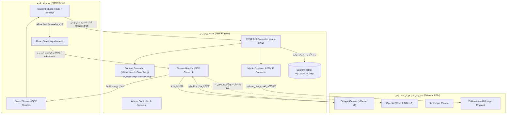

# 🏛️ مستند جامع معماری و ساختار افزونه Omni AI Suite
> **نسخه افزونه:** 1.0.0  
> **محیط هدف:** WordPress 6.x + PHP 8.1+  
> **فناوری رابط کاربری:** React بومی وردپرس (`@wordpress/element` و `@wordpress/components`)  
> **نوع معماری:** ماژولار، کلاینت‌محور با پردازش سمت سرور، بدون افزونگی دیتابیس (Zero CPT Bloat)

---

## ۱. نمای کلی و فلسفه طراحی (Philosophy & Architecture)

افزونه **Omni AI Suite** یک پلتفرم جامع و فوق‌سریع هوش مصنوعی برای مدیریت و تولید محتوا، زمان‌بندی، تولید انبوه، تولید تصویر شاخص و چت‌بات در وردپرس است. این افزونه بر اساس ۵ اصل کلیدی توسعه یافته است:

1. **طراحی بومی بدون سربار (Native & Lightweight):**  
   رابط کاربری ادمین به صورت یک SPA مدرن با کتابخانه‌های پیش‌فرض هسته وردپرس (`@wordpress/element` و `@wordpress/components`) ساخته شده است. این رویکرد حجم باندل را زیر ۱۰۰ کیلوبایت نگه می‌دارد و نیاز به بارگذاری React یا کتابخانه‌های سنگین خارجی را به صفر می‌رساند.
2. **پشتیبانی از چندین ارائه‌دهنده (Multi-Provider BYOK & Failover):**  
   پشتیبانی همزمان از **Google Gemini**، **OpenAI** و **Anthropic Claude** با امکان تعیین ارائه‌دهنده اصلی و ارائه‌دهنده پشتیبان (Automatic Failover) در صورت قطعی یا خطای سهمیه.
3. **عدم افزونگی دیتابیس (Zero CPT Bloat):**  
   لاگ‌ها و آمار تولید محتوا در جدول اختصاصی دیتابیس (`wp_omni_ai_logs`) ذخیره می‌شوند و جدول `wp_posts` را با هزاران پست موقت یا متادیتا آلوده نمی‌کنند.
4. **استریم زنده واقعی (Server-Sent Events - SSE):**  
   انتقال کاراکتر به کاراکتر پاسخ هوش مصنوعی به مرورگر کاربر از طریق پروتکل SSE و مدیریت بافر cURL در PHP بدون تایم‌اوت Nginx/Apache.
5. **معماری کاملاً ماژولار (Zero Asset Pollution):**  
   هر ماژول (گوتنبرگ، المنتور، ووکامرس، چت‌بات) فقط در صورت فعال بودن بارگذاری می‌شود و در صفحات نامرتبط هیچ فایل CSS یا JS اضافی لود نخواهد شد.

---

## ۲. نمودار جریان داده و معماری (System Flow Diagram)



---

## ۳. ساختار درختی فایل‌ها و پوشه‌ها (File Map)

```text
omni-ai-suite/
│
├── omni-ai-suite.php                   # نقطه ورود اصلی افزونه و تعریف ثابت‌ها
├── uninstall.php                       # اسکریپت حذف تمیز پلاگین و پاک‌سازی دیتابیس
├── package.json                        # متادیتا و اسکریپت‌های توسعه
├── tailwind.config.js                  # پیکربندی استایل اسکوپ‌شده ادمین
├── README.md                           # راهنمای سریع افزونه
├── ARCHITECTURE.md                     # مستندات جامع معماری و ساختار مهندسی افزونه
│
├── assets/                             # فایل‌های فرانت‌اند و دارایی‌های استاتیک
│   ├── css/
│   │   ├── admin.css                   # استایل‌های بهینه‌شده اسکوپ‌شده برای بخش ادمین
│   │   └── chatbot.css                 # استایل ویجت چت‌بات شناور سایت
│   └── js/
│       ├── admin.js                    # باندل کامل React SPA دوزبانه (FA/EN)
│       ├── admin.asset.php             # وابستگی‌های اسکریپت ادمین (wp-element, wp-components)
│       ├── chatbot.js                  # اسکریپت فرانت‌اند ویجت چت‌بات
│       ├── elementor.js                # پنل هوش مصنوعی ادغام‌شده با ویرایشگر المنتور
│       ├── gutenberg.js                # سایدبار و نوار ابزار اختصاصی گوتنبرگ
│       ├── gutenberg.asset.php          # وابستگی‌های اسکریپت گوتنبرگ
│       └── woocommerce.js              # دکمه‌های تولید خودکار توضیحات محصول ووکامرس
│
├── includes/                           # هسته کدها و کلاس‌های PHP
│   ├── class-plugin.php                # کلاس اصلی راه‌انداز افزونه و ثبت هوک‌ها
│   ├── class-autoloader.php            # لودر خودکار کلاس‌ها مطابق استاندارد PSR-4
│   ├── class-activator.php             # عملیات فعال‌سازی (ساخت جدول اختصاصی لاگ‌ها)
│   ├── class-deactivator.php           # عملیات غیرفعال‌سازی و پاک‌سازی کرون‌جاب‌ها
│   │
│   ├── admin/                          # بخش مدیریت وردپرس
│   │   └── class-admin.php             # ساخت منوها، زیرمنوها و بارگذاری دارایی‌ها با wp_localize_script
│   │
│   ├── api/                            # لایه ارتباطی REST API
│   │   ├── class-rest-controller.php   # کنترلر اصلی کلیه اندپوینت‌های REST، پارسر مارک‌داون و ذخیره پست
│   │   └── class-stream-handler.php    # کنترلر اختصاصی استریم زنده SSE با cURL و فیل‌اور
│   │
│   ├── database/                       # لایه پایگاه داده اختصاصی
│   │   └── class-log-repository.php    # عملیات CRUD جدول لاگ‌ها، دریافت تاریخچه و تجمیع توکن‌ها
│   │
│   ├── modules/                        # لایه ماژولار و افزونه‌های کمکی
│   │   ├── interface-module.php        # اینترفیس استاندارد ماژول‌ها
│   │   ├── class-module-manager.php    # کنترل و فعال/غیرفعال‌سازی پویای ماژول‌ها
│   │   ├── class-content-module.php    # ماژول استودیو محتوا
│   │   ├── class-bulk-module.php       # ماژول تولید انبوه با Action Scheduler
│   │   ├── class-gutenberg-module.php  # ماژول ادغام با ویرایشگر گوتنبرگ
│   │   ├── class-elementor-module.php  # ماژول ادغام با المنتور
│   │   ├── class-woocommerce-module.php# ماژول تولید محتوای هوشمند ووکامرس
│   │   └── class-chatbot-module.php    # ماژول چت‌بات پشتیبانی هوشمند سایت
│   │
│   └── providers/                      # لایه ارائه‌دهندگان هوش مصنوعی (AI Engines)
│       ├── interface-ai-provider.php   # اینترفیس رسمی کلیه پرووایدرهای AI
│       ├── class-provider-factory.php  # فکتوری حل کلیدها، اولویت‌بندی و دریافت پرووایدر فعال
│       ├── class-gemini-provider.php   # درایور Google Gemini (v1beta/v1، استریم SSE، کش و فیلتر مدل‌ها)
│       ├── class-openai-provider.php   # درایور OpenAI (GPT-4o, o3, DALL-E 3)
│       └── class-claude-provider.php   # درایور Anthropic Claude (Claude 3.5 Sonnet & Haiku)
│
└── languages/                          # فایل‌های ترجمه و محلی‌سازی
    └── omni-ai-suite-fa_IR.po          # فایل منبع ترجمه زبان فارسی
```

---

## ۴. شرح اجزای کلیدی سیستم (Core Components)

### ۱. لایه پرووایدرها و کارخانه مدل‌ها (`OmniAI\Providers`)
- **`AI_Provider_Interface`:** تمام سرویس‌ها متدهای `generate()`, `stream()`, `fetch_live_models()`, `get_supported_models()`, `is_configured()` را پیاده‌سازی می‌کنند.
- **`Provider_Factory`:** وظیفه دارد کلیدهای API را ابتدا از تنظیمات افزونه و در صورت خالی بودن از رابط اتصال‌دهنده‌های وردپرس (`options-connectors.php`) استعلام کند. همچنین مدیریت ارائه‌دهنده اصلی و پشتیبان را بر عهده دارد.
- **`Gemini_Provider`:**
  - پشتیبانی از مدل‌های رسمی نسل ۳ گوگل: `gemini-3.8-flash` (اصلی)، `gemini-3.6-flash`، `gemini-3.5-flash`، `gemini-3.1-pro-preview` و سری پایدار `1.5`.
  - استعلام زنده مدل‌ها (`fetch_live_models`) به همراه فیلتر دقیق مدل‌های تصویری (`imagen`, `image`)، مدل‌های صوتی و مدل‌های منسوخ (`gemini-2.0`, `gemini-2.5`).
  - سقف توکن خروجی تا **۸،۱۹۲ توکن** برای جلوگیری از نیمه‌کاره ماندن متن.

### ۲. موتور استریم زنده (`Stream_Handler`)
- درخواست ورودی را اعتبارسنجی کرده و هدرهای `Content-Type: text/event-stream` و `X-Accel-Buffering: no` را ارسال می‌کند.
- بافر خروجی PHP را پاک‌سازی کرده و از طریق `CURLOPT_WRITEFUNCTION` چانک‌های متن را در لحظه دریافت و در قالب پکت‌های SSE به صورت `data: {"text": "...", "done": false}` مخابره می‌کند.
- در صورت بروز خطای اتصال، به صورت نامحسوس روی ارائه‌دهنده پشتیبان (Failover) سوییچ می‌کند.

### ۳. پردازش و ذخیره پیش‌نویس (`handle_create_draft` & `Content_Formatter`)
- **استخراج متادیتا (Metadata Auto-Parser):**
  - **عنوان:** استخراج خودکار از خط `**عنوان مقاله:**` یا `# ...`
  - **اسلاگ انگلیسی:** استخراج از خط `**اسلاگ انگلیسی:**` و تبدیل به Kebab-case استاندارد (`post_name`)
  - **چکیده:** استخراج متاتوضیحات از خط `**چکیده مقاله:**` و ذخیره در `post_excerpt`
  - **دسته‌بندی:** انتساب مستقیم به دسته انتخابی کاربر (`post_category`)
- **تبدیل مارک‌داون به بلوک‌های بومی گوتنبرگ (`markdown_to_gutenberg`):**
  - متن خروجی را بررسی کرده و تگ‌های مارک‌داون را به ساختار استاندارد کامنت‌های گوتنبرگ (`<!-- wp:heading -->`, `<!-- wp:table -->`, `<!-- wp:list -->`, `<!-- wp:paragraph -->`, `<!-- wp:separator -->`) تبدیل می‌کند تا مقاله در ادیتور وردپرس بدون هیچ علامت خام `**` یا پایپ `|` نمایش داده شود.

### ۴. موتور تولید و بهینه‌سازی تصویر شاخص (`attach_featured_image`)
- تولید پرامپت اختصاصی و انگلیسی به صورت خودکار از روی عنوان و موضوع مقاله در ۵ سبک بصری:
  - سه بعدی مدرن ایزومتریک (`isometric_3d`)
  - وکتور فلت مدرن (`flat_vector`)
  - عکس استودیویی باکیفیت (`photoreal`)
  - دیجیتال آرت سایبر و فناوری (`cyber_tech`)
  - مینیمال شرکتی (`corporate`)
- دانلود تصویر با `download_url()` و بهینه‌سازی و تبدیل خودکار به فرمت کم‌حجم و مدرن **WebP** توسط ویرایشگر تصویر وردپرس (`wp_get_image_editor`).
- ثبت در رسانه‌های وردپرس و الصاق مستقیم به عنوان تصویر شاخص نوشته (`set_post_thumbnail`).

### ۵. مدیریت قالب‌های پرامپت (Prompt Templates Manager)
- امکان افزودن، ذخیره، ویرایش و حذف قالب‌های پرامپت اختصاصی کاربر از طریق اندپوینت‌های `/wp-json/omni-ai/v1/prompts`.
- مجهز به پرامپت‌های مستر سئو و آموزشی به صورت پیش‌فرض در رابط کاربری استودیو.

---

## ۵. پایگاه داده و جدول اختصاصی (Database Schema)

هنگام فعال‌سازی افزونه (`class-activator.php`)، جدول زیر در پایگاه داده وردپرس ایجاد می‌شود:

```sql
CREATE TABLE `wp_omni_ai_logs` (
  `id` bigint(20) unsigned NOT NULL AUTO_INCREMENT,
  `user_id` bigint(20) unsigned NOT NULL DEFAULT 0,
  `prompt` text NOT NULL,
  `response` longtext NOT NULL,
  `model` varchar(100) NOT NULL DEFAULT '',
  `provider` varchar(50) NOT NULL DEFAULT '',
  `tokens_used` int(11) NOT NULL DEFAULT 0,
  `created_at` datetime NOT NULL DEFAULT CURRENT_TIMESTAMP,
  PRIMARY KEY (`id`),
  KEY `user_id` (`user_id`),
  KEY `provider` (`provider`),
  KEY `created_at` (`created_at`)
) ENGINE=InnoDB DEFAULT CHARSET=utf8mb4 COLLATE=utf8mb4_unicode_ci;
```

---

## ۶. مشخصات اندپوینت‌های REST API

کلیه اندپوینت‌ها تحت نیم‌اسپیس `omni-ai/v1` در دسترس هستند و اعتبارسنجی آن‌ها از طریق `X-WP-Nonce` انجام می‌پذیرد:

| مسیر (Route) | متد | سطح دسترسی | شرح عملکرد |
| :--- | :---: | :---: | :--- |
| `/stream-ai` | `POST` | `edit_posts` | استریم زنده محتوا از طریق پروتکل SSE |
| `/ask` | `POST` | `edit_posts` | تولید متنی سنکرون و مستقیم |
| `/create-draft` | `POST` | `edit_posts` | ایجاد پیش‌نویس وردپرس با تصویر شاخص WebP و بلوک‌های گوتنبرگ |
| `/save-log` | `POST` | `edit_posts` | ثبت تاریخچه تولید محتوا در جدول اختصاصی دیتابیس |
| `/models` | `GET` | `edit_posts` | دریافت لیست مدل‌های تمیز و فعال تولید محتوا |
| `/models/refresh` | `POST` | `manage_options` | پاک‌سازی کش و استعلام زنده مدل‌ها از سرورهای گوگل/OpenAI |
| `/prompts` | `GET / POST` | `edit_posts` | دریافت و ذخیره قالب‌های پرامپت اختصاصی کاربر |
| `/categories` | `GET` | `edit_posts` | دریافت لیست دسته‌بندی‌های فعال سایت وردپرسی |
| `/settings` | `GET / POST` | `manage_options` | دریافت و ذخیره کلیدهای API و اولویت‌بندی پرووایدرها |
| `/modules` | `GET / POST` | `manage_options` | فعال یا غیرفعال‌سازی ماژول‌های ۵گانه |
| `/logs` | `GET / DELETE`| `edit_posts` | مشاهده تاریخچه تولیدات و آمار مصرف توکن‌ها |

---

## ۷. تب‌های پنل مدیریت (Admin SPA Screens)

1. **پیشخوان (Dashboard):** کارت‌های آماری کل تولیدات، تخمین توکن‌های مصرفی، وضعیت اتصال سرویس فعال، میانبرهای سریع و جدول ۱۰ تولید اخیر.
2. **استودیو تولید محتوا (Content Studio):** نوار قالب‌های آماده، پنجره مدیریت پرامپت‌ها، دراپ‌داون مدل‌های متنی، اسلایدر خلاقیت، پنجره زنده خروجی، پنل تنظیمات پیش‌نویس وردپرس (عنوان، اسلاگ، چکیده، دسته‌بندی و تصویر شاخص WebP).
3. **تولید انبوه پست (Bulk Generator):** درج خط به خط عناوین و ثبت صف پردازش در پس‌زمینه بدون تایم‌اوت مرورگر.
4. **تاریخچه و لاگ‌ها (History & Logs):** جدول اختصاصی جستجوپذیر لاگ‌های گذشته با امکان فیلتر بر اساس تاریخ و پرووایدر.
5. **مدیریت ماژول‌ها (Modules):** مدیریت سوییچ‌های گوتنبرگ، المنتور، ووکامرس و چت‌بات.
6. **تنظیمات (BYOK Settings):** ثبت کلیدهای اختصاصی کاربر، سوییچ بین Gemini / OpenAI / Claude، اولویت‌بندی پشتیبان (Failover) و دکمه بروزرسانی زنده مدل‌ها.
